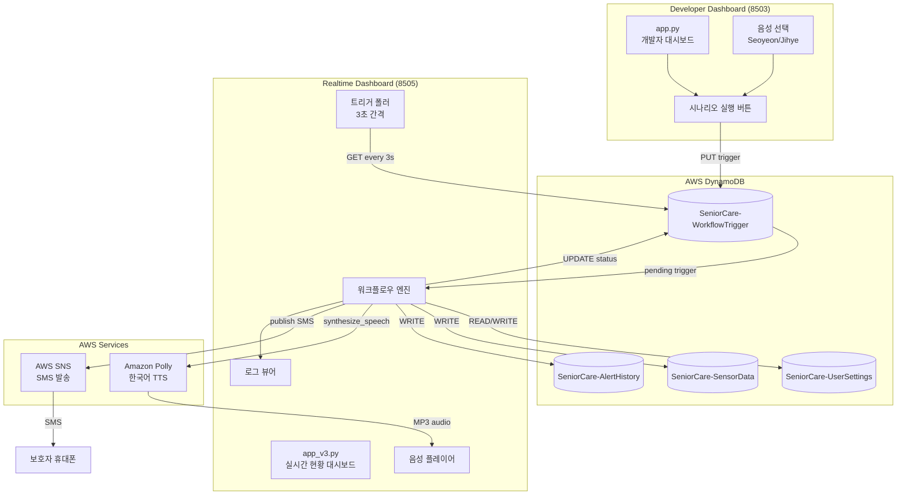

# Design Document: 실시간 현황 대시보드 자동 활성화 및 음성 안내

## Overview

이 설계 문서는 실시간 현황 대시보드(포트 8505)의 자동 활성화 및 음성 안내 기능에 대한 기술적 설계를 정의합니다. 개발자 대시보드(포트 8503)에서 시나리오를 실행하면, 실시간 현황 대시보드가 DynamoDB의 워크플로우 트리거 테이블을 폴링하여 자동으로 워크플로우를 감지하고 시작하며, Amazon Polly를 사용한 한국어 음성 안내를 제공합니다.

### 핵심 기능
- DynamoDB 폴링 기반 워크플로우 자동 감지 (3초 간격)
- Amazon Polly 기반 한국어 음성 합성 (Seoyeon/Jihye)
- 5단계 워크플로우 시각화 (센서 수집 → 낙상 감지 → 음성 확인 → 알림 발송 → 완료)
- AWS SNS 기반 실제 SMS 발송
- 워크플로우 완료 후 상태 자동 복구

## Architecture



## Components and Interfaces

### 1. WorkflowTriggerService

워크플로우 트리거 관리를 담당하는 서비스 모듈입니다.

```python
class WorkflowTriggerService:
    """워크플로우 트리거 관리 서비스"""
    
    def __init__(self, dynamodb_resource, table_name: str = 'SeniorCare-WorkflowTrigger'):
        self.table = dynamodb_resource.Table(table_name)
    
    def create_trigger(self, user_id: str, voice: str = 'Seoyeon') -> dict:
        """새 워크플로우 트리거 생성"""
        pass
    
    def get_pending_trigger(self, user_id: str) -> Optional[dict]:
        """pending 상태의 트리거 조회"""
        pass
    
    def update_status(self, user_id: str, status: str, current_step: int = 0) -> bool:
        """트리거 상태 업데이트 (pending → running → completed)"""
        pass
```

### 2. VoiceService

Amazon Polly 기반 음성 합성 서비스입니다.

```python
class VoiceService:
    """Amazon Polly 음성 합성 서비스"""
    
    SUPPORTED_VOICES = ['Seoyeon', 'Jihye']
    DEFAULT_VOICE = 'Seoyeon'
    
    def __init__(self, polly_client, output_dir: str = 'voice_outputs'):
        self.polly = polly_client
        self.output_dir = output_dir
    
    def synthesize(self, text: str, voice_id: str = 'Seoyeon') -> str:
        """텍스트를 음성으로 변환하고 파일 경로 반환"""
        pass
    
    def get_step_message(self, step: int, user_name: str) -> str:
        """워크플로우 단계별 음성 메시지 반환"""
        pass
```

### 3. WorkflowEngine

5단계 워크플로우 실행 엔진입니다.

```python
class WorkflowEngine:
    """워크플로우 실행 엔진"""
    
    STEPS = [
        {'num': 1, 'title': '센서 데이터 수집', 'icon': '📊'},
        {'num': 2, 'title': '낙상 감지', 'icon': '🚨'},
        {'num': 3, 'title': 'AI 스피커 음성 확인', 'icon': '🗣️'},
        {'num': 4, 'title': '보호자 알림 발송', 'icon': '📱'},
        {'num': 5, 'title': '완료', 'icon': '✅'}
    ]
    
    def __init__(self, trigger_service, voice_service, notification_service, user_service):
        self.trigger_service = trigger_service
        self.voice_service = voice_service
        self.notification_service = notification_service
        self.user_service = user_service
    
    def execute(self, user_id: str, voice: str, callbacks: WorkflowCallbacks) -> bool:
        """전체 워크플로우 실행"""
        pass
    
    def execute_step(self, step_num: int, context: dict) -> StepResult:
        """개별 단계 실행"""
        pass
```

### 4. NotificationService

SMS 알림 발송 서비스입니다.

```python
class NotificationService:
    """알림 발송 서비스"""
    
    def __init__(self, sns_client):
        self.sns = sns_client
    
    def format_phone_number(self, phone: str) -> str:
        """전화번호 포맷 변환 (010-XXXX-XXXX → +8210XXXXXXXX)"""
        pass
    
    def send_sms(self, phone: str, message: str) -> dict:
        """SMS 발송 및 결과 반환"""
        pass
```

### 5. LogService

워크플로우 로그 관리 서비스입니다.

```python
class LogService:
    """워크플로우 로그 관리"""
    
    LOG_LEVELS = ['INFO', 'SUCCESS', 'WARNING', 'ERROR']
    MAX_ENTRIES = 30
    
    def __init__(self):
        self.logs = []
    
    def add(self, message: str, level: str = 'INFO') -> None:
        """로그 추가 (KST 타임스탬프 포함)"""
        pass
    
    def get_recent(self, count: int = 30) -> list:
        """최근 로그 반환"""
        pass
```

## Data Models

### WorkflowTrigger (DynamoDB)

```json
{
  "userId": "test-user-001",
  "triggerId": "latest",
  "status": "pending | running | completed",
  "voice": "Seoyeon | Jihye",
  "currentStep": 0,
  "triggeredAt": "2024-01-15T10:30:00+09:00",
  "triggeredBy": "developer-dashboard",
  "updatedAt": "2024-01-15T10:30:05+09:00"
}
```

### UserSettings (DynamoDB)

```json
{
  "userId": "test-user-001",
  "name": "김영희",
  "age": 75,
  "status": "active | emergency | alert",
  "lastActivityTime": "2024-01-15T10:25:00+09:00",
  "inactivityThreshold": 120,
  "voiceResponseTimeout": 30,
  "guardianName": "김철수",
  "guardianPhone": "010-1234-5678",
  "guardianEmail": "guardian@example.com",
  "guardianRelation": "자녀"
}
```

### WorkflowStep (Internal)

```python
@dataclass
class WorkflowStep:
    num: int
    title: str
    icon: str
    desc: str
    status: str  # 'inactive' | 'active' | 'success' | 'warning'
```

### LogEntry (Internal)

```python
@dataclass
class LogEntry:
    timestamp: str  # KST format "HH:MM:SS"
    level: str      # INFO | SUCCESS | WARNING | ERROR
    message: str
```

## Correctness Properties

*A property is a characteristic or behavior that should hold true across all valid executions of a system-essentially, a formal statement about what the system should do. Properties serve as the bridge between human-readable specifications and machine-verifiable correctness guarantees.*

### Property 1: 트리거 상태 전이 일관성

*For any* 워크플로우 트리거에 대해, 상태는 반드시 'pending' → 'running' → 'completed' 순서로만 전이되어야 하며, 역방향 전이나 상태 건너뛰기가 발생해서는 안 됩니다.

**Validates: Requirements 1.4, 1.5**

### Property 2: Pending 트리거 자동 시작

*For any* 'pending' 상태의 트리거가 감지되면, 워크플로우 실행이 자동으로 시작되어야 합니다.

**Validates: Requirements 1.3**

### Property 3: 음성 선택 일관성

*For any* 워크플로우 실행에서, 트리거에 지정된 음성(Seoyeon 또는 Jihye)이 해당 워크플로우의 모든 음성 합성에 일관되게 사용되어야 합니다.

**Validates: Requirements 2.2, 3.4**

### Property 4: 5단계 음성 생성

*For any* 워크플로우 실행에서, 5개의 모든 단계에 대해 음성 메시지가 생성되어야 합니다.

**Validates: Requirements 2.4**

### Property 5: 트리거 데이터 음성 포함

*For any* 개발자 대시보드에서 생성된 워크플로우 트리거에는 선택된 음성 정보가 반드시 포함되어야 합니다.

**Validates: Requirements 3.2, 3.3**

### Property 6: 낙상 감지 단계 스타일링

*For any* 워크플로우 단계 중 2번째 단계(낙상 감지)는 다른 단계와 다른 경고 스타일(warning)이 적용되어야 합니다.

**Validates: Requirements 5.5**

### Property 7: 음성 파일 저장 규칙

*For any* Polly 서비스로 생성된 음성 파일은 'voice_outputs' 디렉토리에 'auto_demo_HHMMSS.mp3' 패턴의 이름으로 MP3 형식으로 저장되어야 합니다.

**Validates: Requirements 6.1, 6.2, 6.5**

### Property 8: 로그 형식 일관성

*For any* 워크플로우 로그 항목은 KST 타임스탬프와 로그 레벨(INFO, SUCCESS, WARNING, ERROR)을 포함해야 하며, 최대 30개까지만 유지되어야 합니다.

**Validates: Requirements 7.1, 7.3, 7.4, 7.5**

### Property 9: 보호자 정보 로드 및 표시

*For any* 워크플로우 시작 시, 보호자 정보(이름, 전화번호, 이메일, 관계)가 UserSettings 테이블에서 로드되어 표시되고 INFO 레벨로 로깅되어야 합니다.

**Validates: Requirements 8.1, 8.2, 8.4**

### Property 10: 전화번호 포맷 변환

*For any* '010-XXXX-XXXX' 형식의 한국 전화번호는 '+8210XXXXXXXX' 형식으로 올바르게 변환되어야 합니다.

**Validates: Requirements 9.2**

### Property 11: SMS 메시지 응급 정보 포함

*For any* 발송되는 SMS 메시지에는 응급상황 정보(사용자명, 상황 설명)가 반드시 포함되어야 합니다.

**Validates: Requirements 9.3, 9.4**

### Property 12: 워크플로우 완료 후 상태 복구

*For any* 워크플로우가 모든 단계를 완료하면, 사용자 상태가 'emergency'에서 'active'로 변경되고 UserSettings 테이블에 업데이트되어야 합니다.

**Validates: Requirements 10.1, 10.2, 10.3**

## Error Handling

### 에러 처리 전략

| 에러 유형 | 처리 방법 | 로그 레벨 |
|-----------|-----------|-----------|
| DynamoDB 연결 실패 | 재시도 3회 후 에러 표시 | ERROR |
| Polly 음성 생성 실패 | 에러 로깅 후 다음 단계 진행 | ERROR |
| SNS SMS 발송 실패 | 에러 로깅 후 워크플로우 계속 | ERROR |
| 보호자 정보 없음 | 기본값 사용 및 경고 표시 | WARNING |
| 음성 파일 저장 실패 | 에러 로깅 후 계속 진행 | ERROR |
| 상태 업데이트 실패 | 에러 로깅 | ERROR |

### 에러 복구 메커니즘

```python
class ErrorHandler:
    """에러 처리 및 복구"""
    
    @staticmethod
    def handle_polly_error(error: Exception, log_service: LogService) -> None:
        """Polly 에러 처리 - 로깅 후 계속 진행"""
        log_service.add(f"Polly 오류: {str(error)}", "ERROR")
        # 워크플로우는 계속 진행
    
    @staticmethod
    def handle_sns_error(error: Exception, log_service: LogService) -> None:
        """SNS 에러 처리 - 로깅 후 계속 진행"""
        log_service.add(f"SMS 발송 오류: {str(error)}", "ERROR")
        log_service.add("AWS SNS 권한 또는 설정을 확인하세요", "ERROR")
    
    @staticmethod
    def handle_dynamodb_error(error: Exception, log_service: LogService) -> None:
        """DynamoDB 에러 처리"""
        log_service.add(f"DynamoDB 오류: {str(error)}", "ERROR")
```

## Testing Strategy

### 테스트 접근 방식

이 기능은 **단위 테스트**와 **속성 기반 테스트(Property-Based Testing)**를 병행합니다.

- **단위 테스트**: 특정 예제, 엣지 케이스, 에러 조건 검증
- **속성 테스트**: 모든 입력에 대해 보편적으로 성립해야 하는 속성 검증

### 속성 기반 테스트 설정

- **라이브러리**: Hypothesis (Python)
- **최소 반복 횟수**: 100회
- **태그 형식**: `Feature: dashboard-auto-activation-voice, Property {number}: {property_text}`

### 테스트 케이스

#### 속성 테스트

| Property | 테스트 설명 | 생성기 |
|----------|-------------|--------|
| Property 1 | 상태 전이 순서 검증 | 임의의 트리거 상태 시퀀스 |
| Property 3 | 음성 선택 일관성 | 임의의 음성 ID (Seoyeon/Jihye) |
| Property 7 | 파일명 패턴 검증 | 임의의 시간 값 |
| Property 8 | 로그 형식 검증 | 임의의 로그 메시지와 레벨 |
| Property 10 | 전화번호 변환 | 임의의 한국 전화번호 |
| Property 12 | 상태 복구 검증 | 임의의 사용자 ID |

#### 단위 테스트 (예제 및 엣지 케이스)

| 요구사항 | 테스트 설명 |
|----------|-------------|
| 2.5 | 음성 생성 실패 시 에러 로깅 후 계속 진행 |
| 3.5 | 음성 미지정 시 기본값 'Seoyeon' 사용 |
| 5.1 | 5개 워크플로우 단계 모두 표시 |
| 6.3 | voice_outputs 디렉토리 자동 생성 |
| 6.4 | 파일 저장 실패 시 에러 로깅 후 계속 |
| 8.3 | 보호자 정보 없을 때 기본값 사용 |
| 9.5 | SMS 발송 실패 시 에러 로깅 후 계속 |
| 10.4 | 상태 업데이트 실패 시 에러 로깅 |

### 테스트 예시 코드

```python
from hypothesis import given, strategies as st, settings

# Feature: dashboard-auto-activation-voice, Property 10: 전화번호 포맷 변환
@given(
    first=st.sampled_from(['010']),
    middle=st.text(alphabet='0123456789', min_size=4, max_size=4),
    last=st.text(alphabet='0123456789', min_size=4, max_size=4)
)
@settings(max_examples=100)
def test_phone_number_format_conversion(first, middle, last):
    """한국 전화번호가 국제 형식으로 올바르게 변환되는지 검증"""
    korean_format = f"{first}-{middle}-{last}"
    result = format_phone_number(korean_format)
    
    assert result.startswith('+82')
    assert result[3:].isdigit()
    assert len(result) == 13  # +82 + 10자리

# Feature: dashboard-auto-activation-voice, Property 8: 로그 형식 일관성
@given(
    messages=st.lists(st.text(min_size=1, max_size=100), min_size=0, max_size=50),
    levels=st.lists(st.sampled_from(['INFO', 'SUCCESS', 'WARNING', 'ERROR']), min_size=0, max_size=50)
)
@settings(max_examples=100)
def test_log_format_consistency(messages, levels):
    """로그가 올바른 형식을 유지하고 30개로 제한되는지 검증"""
    log_service = LogService()
    
    for msg, level in zip(messages, levels):
        log_service.add(msg, level)
    
    recent = log_service.get_recent()
    
    assert len(recent) <= 30
    for entry in recent:
        assert entry.level in ['INFO', 'SUCCESS', 'WARNING', 'ERROR']
        assert entry.timestamp  # KST 타임스탬프 존재
```

